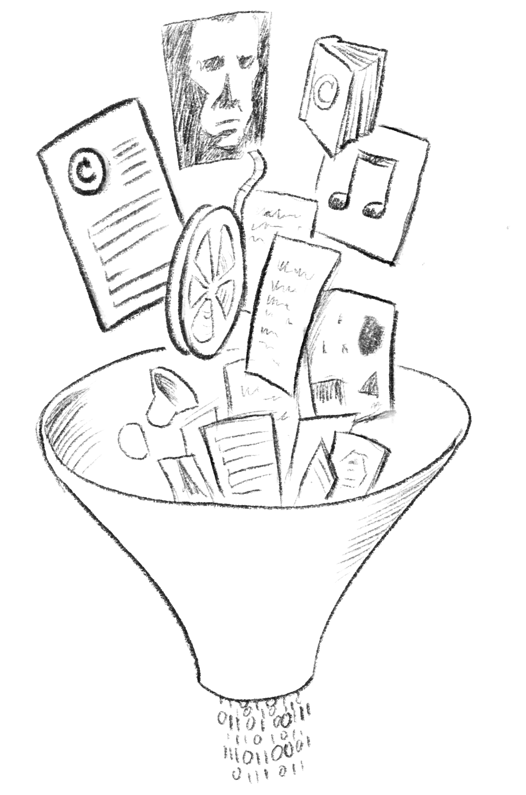
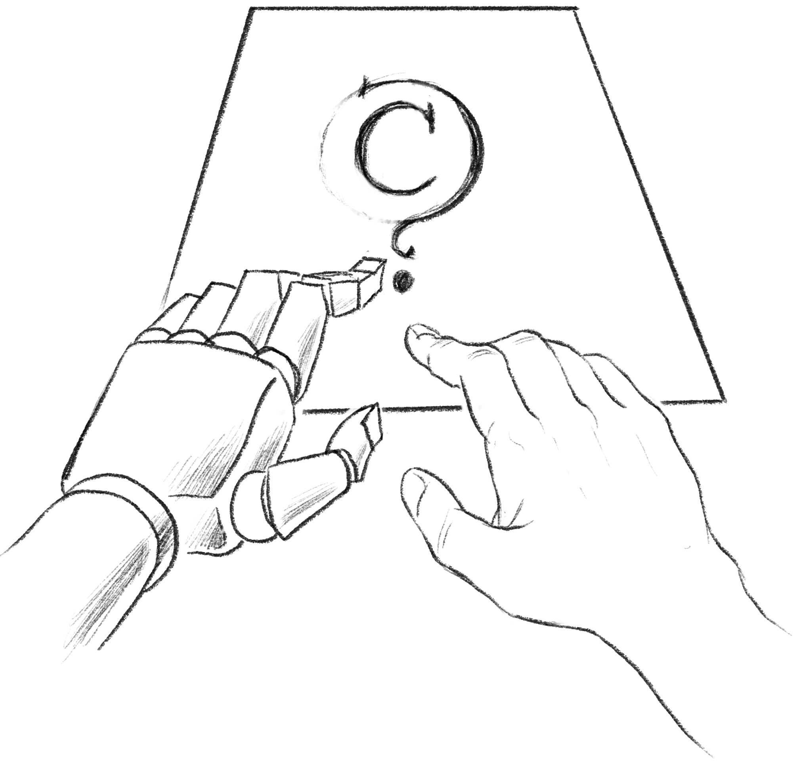
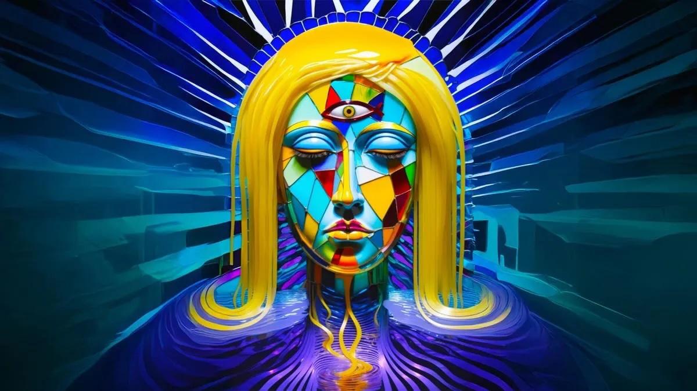

# Copyright

## Intellectual Property
Intellectual property (IP) is a set of legal rights that protect the products of human creativity and ingenuity in the form of inventions, expressions, ideas, symbols, and designs. These rights give the author (or owner, in the case where rights have been transferred) the exclusive right to profit from the use or distribution of the IP. There are several differnet kinds of IP, including **patents**, **copyright**, **trademarks**, **trade secrets**, and **industrial designs** (among others). Each different form of IP has unique requirements, legal regimes, and durations of protection.

## What is Copyright?
Copyright is a form of IP that protects the creators of literary, musical, and artistic works for a limited term (in the US and Canada the term is the creator's life plus 70 years). The limited term is a balance between allowing the author to profit from their work, and the eventual ability for society to freely use and build upon creative outputs.

Works for which copyright has expired, or for which copyright never obtained in the first place (e.g. many government documents, or those works which authors have designated as being copyright-free), are considered to be in the *public domain*. Public domain works are free to be copied, adapted, and published.

The core purpose of copyright is to:
- benefit society by incentivising the creation of new works
- grant creators exclusive rights to benefit financially from their work
- protect the reputation of authors and ensure the integrity of their work
- after an apporopriate period, revert the created work to the public domain to enable cultural enrichment and ongoing creation

In most regions of the world, copyright obtains as soon as the author fixes a unique expression in a medium (whether that be written words, a painted image, musical notation, performance, etc. ). This is true in the United States as well, but a quirk of their copyright regime means that authors must register their work with the US Copyright Office in order to be eligible for statuatory damages in copyright infringment litigation.

## Exceptions to Copyright
Copyright protection is not exclusive. Exceptions exist to protect limited use of copyrighted works for education and cultural discourse. In the US these exceptions are called *fair use*, and in Canada they are called *fair dealing*. Generally, these exceptions allow for the limited use of copyrighted works for various purposes. In Canada, the purposes are enumaerated as:
- Criticism or review
- News reporting
- Research or private study
- Education, and
- Parody

Courts in both countries have shaped the allowable scope of the exempted use in similar ways. Generally, the fairness factors include the purpose of the use, whether the use is transformative or not, the amount of copying, whether there were free alternatives, and the effect on the market and value of the original work.

## Copyright and AI
There are two principal ways in which copyright is implicated in AI:
- **Model training**: In order to create AI models, vast swaths of copyrighted material have been ingested by companies like OpenAI and Anthropic. Did the authors give permission? Were they compensated for the use of their works? In most cases that answers to those questions is no, and there are numerous court cases challenging this usage on copyright grounds.

- **The copyright status of AI output**: what is the copyright status of AI-generated work? Does the human directing the AI system own the copyright to the work?

### Model Training
Gen-AI tools are trained by feeding them vast corpora of data in the form of text, images, audio, or other material. Through complex methods (detailed elsewhere on this site), the models "learn" to identify and replicate patterns. In many cases the data used for training is scraped from publically available sources (e.g. news sources available on the internet, online portfolios, etc.). In some cases the data has been pirated. Some of this material may be in the public domain (e.g. government data sources, older books), but most is under copyright protection. The creators of these books, images, and music have mostly *not* been asked for permission, and have not been compensated for the use of their work. 

This is especially problematic where the outputs of the Gen-AI models may ultimately threaten the creative livelihood of the original creators. 

A number of lawsuits have been initiated by groups of artists, authers, and publishers to prevent AI companies from using their work without consulation, consent, and compensation. 

The litigation landscape here is changing rapidly. Some of these lawsuits have been settled: In September of 2025, the AI giant Anthropic agreed to pay $1.5 billion USD to litigants (Bartz vs Anthropic) whose books had been pirated for training. 

Many AI companies and proponents claim that AI training is *fair use* (or *fair dealing* in the Canadian context). One recent case in the US (Thomson Reuters v. ROSS Intelligence) found that AI training did not constiutute fair use.

The legal and regulatory landscape may change due to various factors. AI proponents are seeking changes to copyright legislation that may weaken creators rights, and allow for mass training on any publicly accessible data. On the other hand, creators' groups are seeking the right to refuse participation in training, and/or the compensation of creators on a rights licenasing model similar to existing organizations in many countries that collect and disburse copyright licensing funds.

### The copyright status of AI output
"Who owns the output of a Gen-AI model?" The answer to that question is not simple. In terms of *property rights*, the answer would be: "the prompter or initiator of the AI model". In terms of *copyright*, the answer would in most cases be: "no one"; the work is in the public domain. In Canada, the US, and most of Europe, *human authorship* is required for a creative work to be eligible for copyright protection. 

Where there is both human and machine contributions to a work, those elements that are human-authored can have copyright protection, but those elements that are machine generated cannot. 

In some jurisdictions, such as the UK, copyright legislation is written to expressly allow copyright protection for AI-generated works. AI companies in North America are lobbying for changes to copyright legislation to allow for copyright protection for AI-generated work.

#### The copyright status of AI output in Canada
In order to be eligible for copyright protection the Canadian Copyright Act (Department of Justice Canada 2024) requires that a work must be: 
- an “expression of an idea with an exercise of skill and judgment”
- fixed in some medium
- original (not a mere copy of another work), and
- authored by a “natural person”. (Library of Parliament 2025)

The copyrightability of AI outputs in Canada is uncertain, due to the fact that AI is not currently addressed in copyright legislation, and at present there are no decided court cases to guide legal interpretation. It is thought, though, that the requirement for skill and judgement and a “natural person” author will prevent AI-generated works that have little human input from obtaining copyright protection. Most experts agree that even the writing of extensive and detailed prompts will not be seen as sufficient control for the granting of copyright. Mixed copyright scenarios are anticipated where, for example, human artists provide a sketch for the AI to render: the visible parts of the human-authored sketch will be eligible for copyright, the AI rendered elements will not.

As an example of current Canadian litigation, in 2021 Ankit Sahni registered a copyright in Canada for an AI generated image (SURYAST). “The Canadian Intellectual Property Office (CIPO) granted the registration through its automated system, a process involving no substantive review of authorship, ownership, or originality.” (Canadian Internet Policy and Public Interest Clinic, n.d.). The grant of copyright is currently being challenged in court by CIPPIC. Notably, the US Copyright Office refused to register SURYAST.

#### The copyright status of AI output in the US

The US Copyright Office has issued a series of reports on AI and copyright (https://www.copyright.gov/ai/), which contain useful and approachable discussions of the issues. Their current understanding supports the centrality of human authorship, but acknowledges situations where mixed copyright may be appropriate.

In their report on AI Copyrightability (United States Copyright Office 2025): “The Report distinguishes between (1) using AI as a tool to assist in creating works (assistive uses, such as de-aging or crowd removal), (2) using AI as a stand-in for human creativity, and (3) using AI as a brainstorming tool. The Report notes (1) assistive uses and (3) brainstorming uses do not limit copyright protection (i.e., copyright can subsist).” (Yi and Chau)

The US court case US v. Thaler is similar to the SURYAST case noted above. The original judgement and initial appeals found that works solely generated by AI are not eligible for copyright (Brittain et al. 2025). In March of 2026, an appeal of this verdict was denied by the US Supreme Court (Jacobs 2026), essentially enshrining the lower court’s opinion that “human authorship is a bedrock requirement of copyright.”

In a more recent case (Fauchoux and Kahn, 2025), the US Copyright Office partially reversed their initial refusal to grant copyright protection to an AI generated work. Kent Keirsey, CEO of AI company Invoke AI, had used his software to generate "A Single Piece of American Cheese" with AI. The Copyright Office initially rejected the claim, but after the author provided extensive documentation of the highly iterative creation process, they protected the “selection, coordination, and arrangement of material generated by artificial intelligence.” However, they expressly disallowed the protection of "2-D artwork, [and] AI generated image components." Some AI advocates see this as vindication, allowing the copyrighting of AI-generated works, but in truth the result is much more murky: some parts of a work my be copyrighted, and others not.

## References

Brittain, Blake, David Bario, Leigh Jones, and Mark Potter. 2025. “US appeals court rejects copyrights for AI-generated art lacking 'human' creator.” Reuters, March 18, 2025. https://www.reuters.com/world/us/us-appeals-court-rejects-copyrights-ai-generated-art-lacking-human-creator-2025-03-18/.

Canadian Internet Policy and Public Interest Clinic. n.d. “CIPPIC v Sahni.” Canadian Internet Policy and Public Interest Clinic. Accessed February 2, 2026. https://www.cippic.ca/our-work/cippic-v-sahni.

Department of Justice Canada. 2024. “Copyright Act (R.S.C., 1985, c. C-42),” Legislation. Copyright Act. https://laws-lois.justice.gc.ca/eng/acts/C-42/Index.html.

Innovation, Science and Economic Development Canada. 2024. “WHAT WE HEARD REPORT Consultation on Copyright in the Age of Generative Artificial Intelligence.” ISED Canada. https://ised-isde.canada.ca/site/strategic-policy-sector/en/marketplace-framework-policy/consultation-paper-consultation-copyright-age-generative-artificial-intelligence.

Library of Parliament. 2025. “Copyright and Artificial Intelligence.” Hillnotes. https://hillnotes.ca/2025/10/27/copyright-and-artificial-intelligence/.

United States Copyright Office. 2025. “Copyright and Artificial Intelligence Part 2: Copyrightability.” U.S. Copyright Office. https://www.copyright.gov/ai/Copyright-and-Artificial-Intelligence-Part-2-Copyrightability-Report.pdf.

Yi, David, and Brian Chau. 2025. “Practical commentary for protecting generative AI art.” Norton Rose Fullbright. https://www.nortonrosefulbright.com/en-ca/knowledge/publications/85e0e39d/practical-commentary-for-protecting-generative-ai-art.

Fauchoux, Vincent; Kahn, Benjamin. Artificial intelligence and copyright: the Invoke decision and "A Single Piece of American Cheese", a landmark decision by the U.S. Copyright Office? https://www.ddg.fr/actualite/artificial-intelligence-and-copyright-the-invoke-decision-and-a-single-piece-of-american-cheese-a-landmark-decision-by-the-u-s-copyright-office?utm_source=chatgpt.com

AUTHOR(S)

Nick Woolridge

Last edited: 03-November-2026

Please report any inaccuracies or suggest updates
